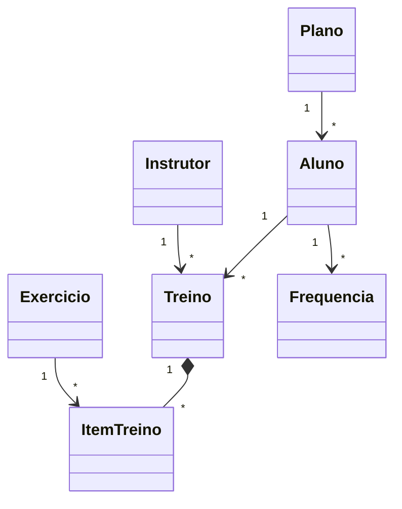

# Gestor de Academia

> **Disciplina:** _preencher_ · **Professor(a):** _preencher_ · **Data:** _preencher_
> **Integrantes:** _Nome 1, Nome 2, Nome 3_

## 1. Descrição

O **Gestor de Academia** é um sistema de terminal em Python que substitui planilhas e fichas de papel na administração de uma academia. Ele permite:

- cadastrar **planos** e **instrutores**;
- **matricular alunos** e identificar as **matrículas vencidas**;
- registrar **check-ins** (frequência);
- montar **fichas de treino** com exercícios, séries e repetições;
- gerar **gráficos de frequência mensal** de cada aluno.

Os dados ficam salvos em um banco **SQLite** (`academia.db`), criado automaticamente na primeira execução.

## 2. Bases de Dados

| Base | Origem | Formato | Uso |
|---|---|---|---|
| `academia.db` | Criada pelo próprio sistema | SQLite (7 tabelas) | Alunos, planos, instrutores, treinos e frequência |
| `data/exercicios.csv` | Elaborada pela equipe (26 exercícios agrupados por grupo muscular) | CSV (`nome`, `grupo_muscular`) | Catálogo de exercícios importado automaticamente no primeiro uso |

**Tabelas do banco:** `plano`, `instrutor`, `aluno`, `exercicio`, `treino`, `item_treino`, `frequencia`, ligadas por chaves estrangeiras.

> Se o professor exigir uma base externa, uma opção é substituir ou ampliar o `exercicios.csv` com um catálogo público de exercícios; a função `importar_exercicios_csv` já aceita qualquer CSV com as colunas `nome` e `grupo_muscular`.

## 3. Justificativa

- **Problema real:** muitas academias de pequeno porte controlam matrículas, vencimentos e treinos em papel ou planilhas soltas, o que gera perda de informação e atraso na cobrança.
- **Escolha do tema:** o domínio tem várias entidades que se relacionam (aluno, plano, instrutor, treino, exercício), o que permite aplicar orientação a objetos e modelagem de banco de dados.
- **Python:** linguagem de sintaxe simples, com ótimo suporte a dados e gráficos.
- **SQLite:** não exige instalação de servidor, o banco é um único arquivo e atende bem ao volume de dados de uma academia pequena.
- **Interface de terminal:** foco na lógica e na arquitetura do sistema, e não no visual.

## 4. Bibliotecas

| Biblioteca | Tipo | Para que serve |
|---|---|---|
| `sqlite3` | Biblioteca padrão | Acesso ao banco de dados |
| `dataclasses` | Biblioteca padrão | Declaração das classes de domínio |
| `datetime` | Biblioteca padrão | Datas de matrícula, vencimento e check-ins |
| `csv` | Biblioteca padrão | Importação do catálogo de exercícios |
| `unittest` | Biblioteca padrão | Testes automatizados |
| `matplotlib` | Externa | Gráfico de frequência mensal |
| `pandas` | Externa | Reservada para análises e relatórios sobre os dados |

Instalação das externas: `pip install -r requirements.txt`

## 5. Diagrama de Classes

Veja [docs/diagrama_classes.md](docs/diagrama_classes.md) (o GitHub renderiza o diagrama).



## 6. Estrutura do Repositório

```
gestor-academia/
├── README.md                 # este relatório
├── requirements.txt
├── src/
│   ├── models.py             # classes de domínio
│   ├── academia.py           # regras de negócio + SQLite
│   └── main.py               # menu de terminal
├── data/exercicios.csv       # catálogo de exercícios
├── tests/test_academia.py    # testes automatizados
└── docs/
    ├── diagrama_classes.md
    └── evidencias/           # prints e gráficos
```

## 7. Como Executar

```bash
git clone https://github.com/SEU_USUARIO/gestor-academia.git
cd gestor-academia
pip install -r requirements.txt
python src/main.py
```

Rodar os testes:

```bash
python -m unittest discover tests
```

## 8. Distribuição de Tarefas

> Ajuste os nomes e a divisão conforme o tamanho do grupo.

| Integrante | Tarefa | Arquivos | Status |
|---|---|---|---|
| _Nome 1_ | Modelagem das classes e diagrama de classes | `models.py`, `docs/diagrama_classes.md` | ✅ Concluído |
| _Nome 2_ | Banco de dados e regras de negócio | `academia.py` | ✅ Concluído |
| _Nome 3_ | Interface de terminal e gráficos | `main.py` | ✅ Concluído |
| _Nome 4_ | Testes, catálogo de exercícios e relatório | `tests/`, `data/`, `README.md` | ✅ Concluído |

O histórico de commits de cada integrante e as Issues do GitHub comprovam essa divisão (ver evidências).

## 9. Evidências

> Adicione aqui os prints da pasta `docs/evidencias/` (veja o `LEIA-ME.txt` dessa pasta).

```markdown


```

## 10. Melhorias Futuras

- Interface gráfica (Tkinter ou Streamlit)
- Controle de pagamentos e mensalidades em atraso
- Relatórios de alunos mais frequentes com `pandas`
