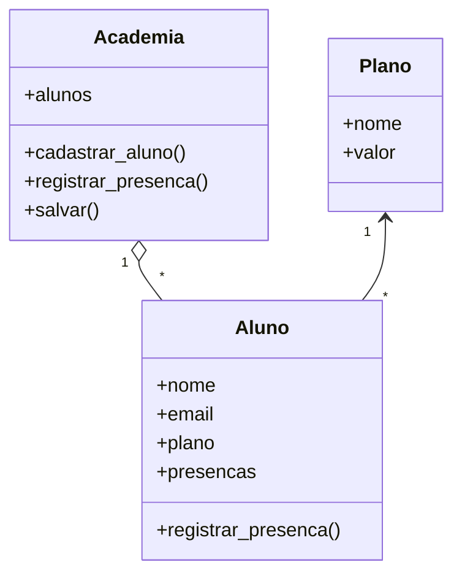

# Gestor de Academia

**Disciplina:** _preencher_ | **Professor(a):** _preencher_
**Integrantes:** _Nome 1, Nome 2, Nome 3_

## 1. Descrição
Programa em Python, feito para rodar no terminal, que ajuda a administrar uma academia. Com ele é possível:
- cadastrar e remover alunos;
- escolher o plano de cada aluno (Mensal, Trimestral ou Anual);
- registrar a presença diária;
- consultar quantas vezes cada aluno treinou.

## 2. Bases de Dados
Os dados ficam em um arquivo **CSV** (`dados/alunos.csv`), criado automaticamente pelo programa quando o primeiro aluno é cadastrado.

| Coluna | Conteúdo |
|---|---|
| nome | Nome do aluno |
| email | E-mail (identifica o aluno, não pode repetir) |
| plano | Mensal, Trimestral ou Anual |
| data_matricula | Data do cadastro |
| presencas | Datas de treino separadas por `;` |

## 3. Justificativa
Muitas academias pequenas controlam alunos e presença em papel ou em anotações soltas, o que causa perda de informação. Este sistema organiza esses dados de forma simples. O tema permite aplicar **orientação a objetos** (classes `Plano`, `Aluno` e `Academia`) e **armazenamento de dados em arquivo**. Usamos CSV porque é um formato simples, que qualquer pessoa consegue abrir no Excel.

## 4. Bibliotecas
Todas fazem parte do Python, então **não é preciso instalar nada**.

| Biblioteca | Para que serve |
|---|---|
| `csv` | Ler e gravar o arquivo `alunos.csv` |
| `os` | Criar a pasta `dados` e verificar se o arquivo existe |
| `datetime` | Pegar a data de hoje para registrar matrícula e presença |

## 5. Diagrama de Classes
Veja [diagrama_classes.md](diagrama_classes.md).



## 6. Como Executar
1. Instale o Python (python.org).
2. Baixe este repositório (**Code → Download ZIP**) e extraia.
3. Abra o terminal dentro da pasta e rode:

```
python main.py
```

(No Mac/Linux pode ser `python3 main.py`.)

## 7. Distribuição de Tarefas

| Integrante | Tarefa | Status |
|---|---|---|
| _Nome 1_ | Classes `Plano` e `Aluno` | Concluído |
| _Nome 2_ | Classe `Academia` e salvamento no CSV | Concluído |
| _Nome 3_ | Menu do programa | Concluído |
| _Nome 4_ | Diagrama de classes e relatório | Concluído |

## 8. Evidências
Adicione os prints na pasta `docs/evidencias/` e coloque aqui, por exemplo:

```


```
