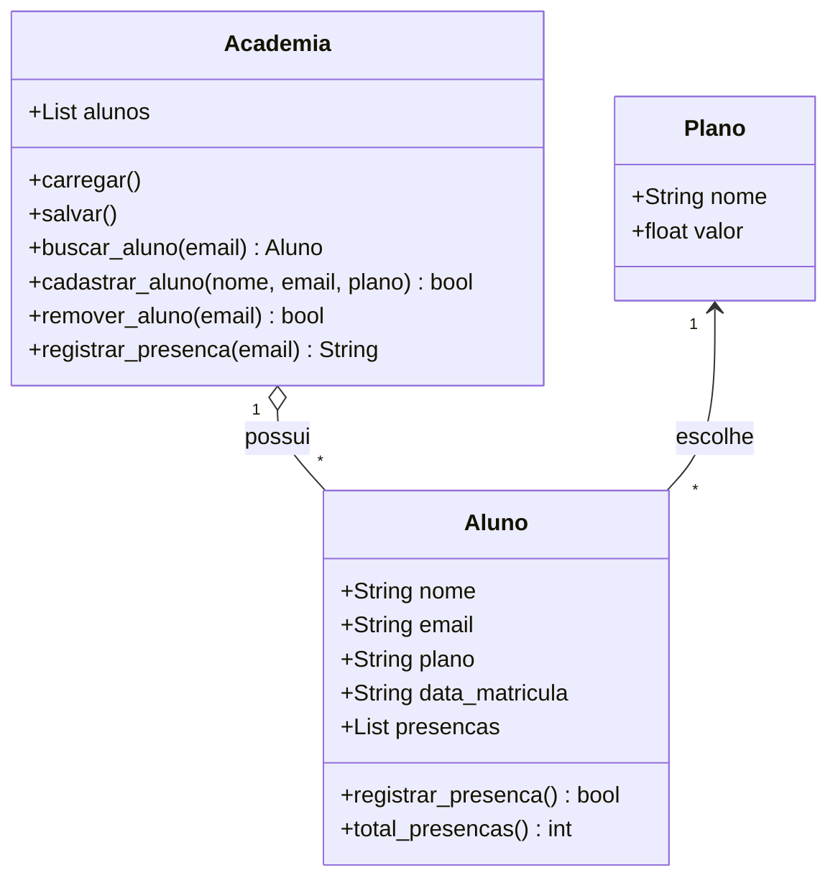

# Diagrama de Classes: Gestor de Academia

O GitHub desenha o diagrama abaixo automaticamente.

## Explicação

| Classe | O que faz |
|---|---|
| `Plano` | Guarda o nome e o valor de um plano (Mensal, Trimestral, Anual). |
| `Aluno` | Guarda os dados de um aluno e as datas em que ele treinou. |
| `Academia` | Guarda a lista de alunos e salva/carrega os dados no arquivo CSV. |
