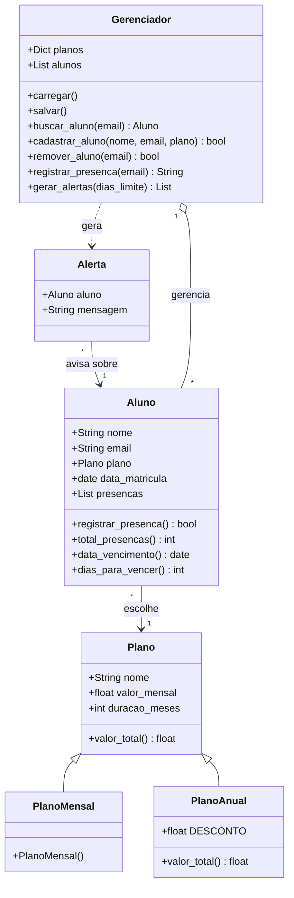

# Gestor de Academia

**Disciplina:** _preencher_ | **Professor(a):** _preencher_ | **Data:** _preencher_
**Integrantes:** _Nome 1, Nome 2, Nome 3_

## 1. Descrição

Programa em Python, feito para rodar no terminal, que ajuda a administrar uma academia. Com ele é possível:

- cadastrar e remover alunos;
- escolher o plano de cada aluno (**Mensal** ou **Anual**);
- registrar a presença diária e consultar quantas vezes cada aluno treinou;
- ver **alertas** de alunos com a matrícula vencida ou perto de vencer (7 dias ou menos).

## 2. Bases de Dados

Os dados ficam em um arquivo **CSV** (`dados/alunos.csv`), criado automaticamente pelo programa quando o primeiro aluno é cadastrado.

| Coluna | Conteúdo |
|---|---|
| nome | Nome do aluno |
| email | E-mail (identifica o aluno, não pode repetir) |
| plano | Mensal ou Anual |
| data_matricula | Data do cadastro (AAAA-MM-DD) |
| presencas | Datas de treino separadas por `;` |

## 3. Justificativa

Muitas academias pequenas controlam alunos, presença e vencimento de matrícula em papel ou em anotações soltas, o que causa perda de informação e atraso na cobrança. Este sistema organiza esses dados de forma simples e avisa quando uma matrícula está vencendo.

O tema permite aplicar os principais conceitos de **orientação a objetos**:

- **Herança:** `PlanoMensal` e `PlanoAnual` herdam de `Plano`.
- **Polimorfismo:** `PlanoAnual` sobrescreve `valor_total()` para aplicar 20% de desconto.
- **Encapsulamento e composição:** cada `Aluno` tem um `Plano`; o `Gerenciador` administra os alunos.

Usamos CSV porque é um formato simples, que qualquer pessoa abre no Excel.

## 4. Bibliotecas

Todas fazem parte do Python, então **não é preciso instalar nada**.

| Biblioteca | Para que serve |
|---|---|
| `csv` | Ler e gravar o arquivo `alunos.csv` |
| `os` | Criar a pasta `dados` e verificar se o arquivo existe |
| `datetime` | Datas de matrícula, presença e vencimento |

## 5. Diagrama de Classes



| Classe | Arquivo | O que faz |
|---|---|---|
| `Plano` | `src/models/plano.py` | Classe base: nome, valor mensal, duração e valor total. |
| `PlanoMensal` | `src/models/plano_mensal.py` | Plano de 1 mês, sem desconto. |
| `PlanoAnual` | `src/models/plano_anual.py` | Plano de 12 meses, com 20% de desconto. |
| `Aluno` | `src/models/aluno.py` | Dados do aluno, presenças e data de vencimento. |
| `Alerta` | `src/models/alerta.py` | Aviso de matrícula vencida ou perto de vencer. |
| `Gerenciador` | `src/services/gerenciador.py` | Regras do sistema e leitura/gravação do CSV. |

## 6. Estrutura do Repositório

```
gestor-academia/
├── README.md
├── requirements.txt
├── .gitignore
├── docs/
│   ├── Diagrama.png
│   ├── relatorio.md
│   └── evidencias/        # prints do projeto
└── src/
    ├── main.py            # menu do programa
    ├── models/            # classes (Plano, Aluno, Alerta...)
    └── services/
        └── gerenciador.py
```

## 7. Como Executar

1. Instale o Python 3 (python.org).
2. Baixe o repositório (**Code → Download ZIP**) e extraia.
3. Abra o terminal na pasta do projeto e rode:

```
python src/main.py
```

(No Mac/Linux pode ser `python3 src/main.py`.)

## 8. Distribuição de Tarefas

> Ajuste os nomes conforme o seu grupo.

| Integrante | Tarefa | Arquivos | Status |
|---|---|---|---|
| _Nome 1_ | Classes de plano (herança) | `plano.py`, `plano_mensal.py`, `plano_anual.py` | Concluído |
| _Nome 2_ | Classes `Aluno` e `Alerta` | `aluno.py`, `alerta.py` | Concluído |
| _Nome 3_ | Gerenciador e salvamento no CSV | `gerenciador.py` | Concluído |
| _Nome 4_ | Menu, diagrama e relatório | `main.py`, `docs/` | Concluído |

## 9. Evidências

Os prints ficam na pasta `docs/evidencias/`. Depois de adicioná-los, apague os `#` abaixo para as imagens aparecerem:

```
# 
# 
# 
# 
# 
```
